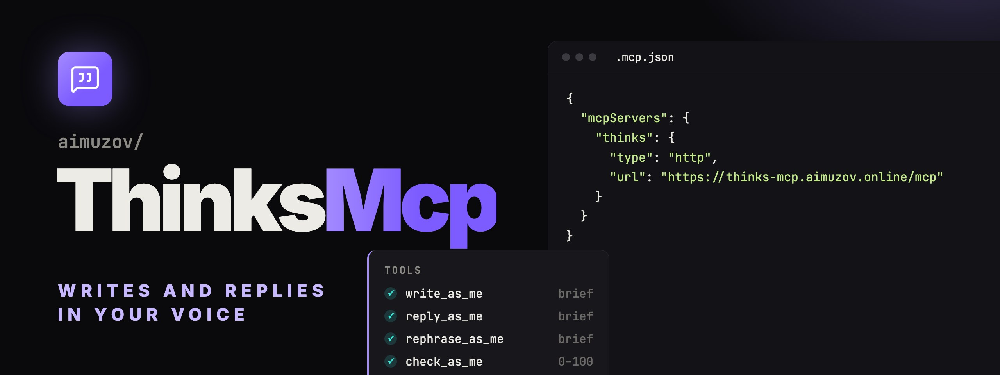

<p align="center">
	
	<a href="README.ru.md"></a>
</p>

<p align="center">
	
</p>

<p align="center">
	<a href="https://github.com/aimuzov/thinks-mcp/actions/workflows/check.yml"></a>
	<a href="https://github.com/aimuzov/thinks-mcp/releases"></a>
	<a href="package.json"></a>
	<a href="https://modelcontextprotocol.io"></a>
	<a href="LICENSE"></a>
</p>

<h3 align="center">Your own voice as an MCP tool</h3>
<p align="center">A style profile and your real messages from a Telegram export, no API keys and no generation of its own</p>

An MCP server that writes, replies and rephrases in your own voice, learned from
a Telegram export and your git history.

The server generates nothing itself and calls no API. It hands the calling model
a **brief**: a measured style profile, real messages of yours picked for the
request, numeric constraints and an output contract. The model writes — Claude
Code, Claude Desktop, whatever you use.

The server speaks Russian: tool descriptions, briefs, the profile and the CLI
are all in Russian, and the style probes — clerical phrases, stop words,
redaction placeholders — assume a Russian-language archive. English is handled
in search and in the code registers, where both languages occur.

## How it works

Two phases with a SQLite file between them.

**Build** (manual, rare): export → filter → redact → group messages into turns →
measure → index.

**Serve** (the MCP server): tool call → BM25 search over the archive → brief.

The unit of the corpus is a **turn**, not a message: a run of messages sent
within 90 seconds of each other. That is what real chat looks like — a sizeable
share of messages arrive in bursts, a thought split across several short replies
instead of one paragraph. Indexing single messages would teach the opposite.

## Two ways to use it

- **Hosted connector** at `https://thinks-mcp.aimuzov.online/mcp`: sign in with
  Telegram, upload the export on the account page, and the corpus is built on
  the server. Nothing to install.
- **Local server** over stdio: the export and the index stay on your machine,
  and the code corpus from your repositories is available too.

## Install

Node 26 or newer. The corpus and the search are built on `node:sqlite` with
FTS5, and the shared kit underneath targets Node 26.

### Through npx or mise

```bash
npx -y @aimuzov/thinks-mcp where
mise use -g npm:@aimuzov/thinks-mcp
```

### From source

```bash
npm ci && npm pack && npm i -g ./aimuzov-thinks-mcp-*.tgz
```

Note that `npm i -g` installs the binary into whichever Node version is active
at that moment. If mise switches versions, `thinks-mcp` disappears from `PATH` —
so in an MCP host config prefer `npx` or `mise exec` over relying on the bare
command name.

## Building the chat corpus

Export your archive from Telegram: Settings → Advanced → Export Telegram data,
JSON format, uncheck every media type (only the text is used). Then:

```bash
thinks-mcp build ~/Downloads/Telegram\ Desktop/DataExport/result.json
```

Order of magnitude: a few hundred thousand messages take about 15 seconds. The
export is parsed into memory whole, and the peak is roughly six times the file
size — about 2.5 GB for a 400 MB export. If Node runs out of heap, raise it:
`NODE_OPTIONS=--max-old-space-size=8192 thinks-mcp build ...`

Where things live and whether they are built:

```bash
thinks-mcp where
thinks-mcp profile
```

## Building the code corpus

A second, independent corpus: comments from your repositories. It exists for the
job the chat corpus is wrong for — writing comments in code.

```bash
THINKS_CODE_EMAILS="me@personal,me@work" thinks-mcp code ~/Projects/*/ ~/work/repo
```

Authorship is resolved with `git blame`: a block enters the corpus only if more
than half of its lines were written from one of those addresses. Other people's
comments, section rules, commented-out code and tool directives
(`eslint-disable`, `shellcheck source=`) are dropped.

It yields two registers: `code` for inline notes, `jsdoc` for docblocks. They
are measured separately because they are different genres — an inline note is
usually one line, a docblock opens with a summary and continues.

A rebuild reuses the previous `git blame` results for files whose contents have
not changed, keyed by blob hash — the difference between half a minute and a few
seconds on a dozen repositories.

Both corpora share one database without interfering: `build` rebuilds only the
chat registers, `code` only the code ones.

The corpus lives in `~/.config/thinks-mcp/style.db` — next to your config, not
next to the code. Otherwise a package upgrade would take it along with the old
version.

## Connecting

### Hosted connector

In Claude: Settings → Connectors → Add custom connector →
`https://thinks-mcp.aimuzov.online/mcp`. In Claude Code:

```bash
claude mcp add --transport http thinks https://thinks-mcp.aimuzov.online/mcp
```

Sign-in goes through the Telegram Login widget. The account page at
`/account` takes the export (JSON, up to 1 GB), builds the corpus in the
background, keeps the settings (marks you never type, chats to skip, the recency
window, the voice mode) and deletes everything on request. The uploaded export
is removed once the build finishes, whatever the outcome; the server keeps
only the index, one per Telegram account.

### Local server

Copy `.mcp.json.example` to `.mcp.json`:

```json
{
	"mcpServers": {
		"thinks": {
			"command": "/opt/homebrew/bin/mise",
			"args": ["exec", "npm:@aimuzov/thinks-mcp", "--", "thinks-mcp"]
		}
	}
}
```

`"command": "npx", "args": ["-y", "@aimuzov/thinks-mcp"]` works the same.

The server starts even with no corpus built and says what to do — so a machine
that has not imported an archive yet gets a working server, not a failed one.

### Voice mode

With `THINKS_VOICE=1`, or the checkbox on the account page, the server sends the
profile as its instructions, and Claude talks to you in your own voice rather
than only writing on your behalf. Instructions are read when a client connects,
so a change works from the next conversation. For clients that ignore
instructions there is the `talk-like-me` prompt.

## Tools

| Tool               | What it does                                            |
| ------------------ | ------------------------------------------------------- |
| `write_as_me`      | brief for writing something from scratch                |
| `reply_as_me`      | brief for answering an incoming message                 |
| `rephrase_as_me`   | brief for rewriting existing text                       |
| `check_as_me`      | deterministic 0–100 score and a list of deviations      |
| `find_my_messages` | search the archive: "how do I usually turn things down" |

Every tool takes a `register`: `dm` for private chat, `group` for group chats,
`longform` for extended writing, `code` for inline comments, `jsdoc` for
docblocks. The profile, the constraints and the search are split by register
because the styles genuinely differ, and `check_as_me` checks different things
for code: line width, markers, filler instead of fact, types in braces.

For comments in code use only `code` and `jsdoc`. The chat registers are
measured on conversation — short replies, colloquial forms, emoji — and in code
they produce somebody else's voice.

`write_as_me` and `find_my_messages` also take `lang` (`ru`/`en`), meaningful
for code, where both are used.

The rest of the parameters:

- `examples` (4–40, default 18) on the three brief tools — how many archive
  examples go into the brief;
- `length` (`short`/`normal`/`long`) on `write_as_me`, relative to what is
  usual for the register;
- `hint` on `reply_as_me` — what the answer should say;
- `limit`, `yearFrom` and `matchIncoming` on `find_my_messages`; the last one
  searches the interlocutors' messages instead of yours.

`check_as_me` takes an optional `code` argument: the lines the comment sits
above. With it the check also catches comments that restate the code. Its
limitation is real — it compares words, so a Russian comment over English
identifiers cannot be judged and the check stays quiet.

Resources: `style://profile` and `style://profile/{register}`, the profile as
markdown. Prompts: `as-me`, `reply-as-me`, `comment-as-me` and `talk-like-me`.

The loop those prompts set up: get a brief → write → `check_as_me` → rewrite
against the findings until the score is high.

## How much a reply example is worth

`reply_as_me` builds its examples from pairs, and pairs come in two kinds.

A message carrying `reply_to_message_id` is a fact: the author picked what they
were answering. Everything else is inferred from message order — "whatever was
said last". That guess fails where chat is most ordinary: someone writes
"Sorry", the answer is about something else entirely, and the pair teaches a
model to reply off-topic.

So quoted pairs rank above inferred ones, and an inferred pair that took the
author more than half an hour to send ranks lower still. Every example says
which kind it is.

Some registers have almost no pairs — a Telegram export of a supergroup carries
hardly any of the other participants' messages. There the brief says so
outright, rather than passing topical matches off as answers.

## Recency

Habits drift over a decade of chat history — punctuation, message length,
rhythm. A profile averaged over the whole archive describes neither the person
you are now nor the one you were ten years ago. So:

- the profile and the constraints are measured over the last few years
  (`THINKS_RECENT_YEARS`), with the all-time numbers shown for reference;
- search results are weighted by year, so a recent example wins all else being
  equal. The weight is set so that a decade of age costs about a third of the
  typical BM25 spread in a result set: recency matters, but an irrelevant new
  message does not outrank a relevant old one.

## Typography

Guillemets, em and en dashes, curly quotes: the typography of a printed book,
which a model reaches for by default. Whether the owner of the archive reaches
for it is decided by measurement — the share of messages carrying each mark,
counted separately for chat and for each code genre. Below 2% the mark enters
the profile as foreign, `check_as_me` penalises it, and the brief asks for a
plain hyphen and straight quotes instead. The threshold is its own rather than
the shared anti-pattern one: a dash in 1% of messages already gives a text away,
while a clerical word at that share does not.

The double hyphen is measured and never penalised. It is not a foreign mark but
an ASCII stand-in for a dash, and it differs by register: absent from chat,
normal in comments. Where its share reaches 1%, the brief asks for it outright.

Comments written with an assistant are a problem of their own. `git blame` calls
them yours while their marks are its: in this author's corpus the share of
guillemets in docblocks jumped from zero to 6% in 2026. Set the year you stopped
writing comments by hand in `THINKS_CODE_HANDWRITTEN_UNTIL`; everything from
that year on stays indexed and searchable but does not count towards the marks.
If a genre keeps fewer than 200 lines after the cut, its marks go unmeasured —
a confident zero over twenty lines is worse than no number.

The ellipsis character `…` and the arrow `→` are measured the same way.

Some marks a threshold cannot settle. An autocorrect or a keyboard layout may
have put `—` into years of handwritten comments, and the archive then calls it
a habit. `THINKS_NEVER_MARKS` is the one rule you declare instead of measure:
`—:--,…:...,→:=>,«:",»:"` lists each mark with what you type in its place.
A declared mark is penalised in every register whatever its measured share,
the finding quotes it with a word on each side and names the stand-in, and
every brief asks for the stand-in.

## Privacy

This is a private message archive, so:

- the export and the built index are never committed — the data directory sits
  outside the repository entirely;
- phone numbers, emails and card numbers are removed using Telegram's own entity
  markup — an export guarantees the entities cover the message text exactly —
  plus fallback regexes for anything left untagged;
- chats, senders and repositories are stored under pseudonyms; real names never
  reach the database;
- surnames are scrubbed from message bodies, first names are not: a bare first
  name identifies nobody, and without them every example would read like a
  redacted document;
- proper nouns are excluded from the style profile separately.

Exclude whole chats: `THINKS_CHAT_STOPLIST="Chat one,Chat two"`.

## Commands

```bash
thinks-mcp build <dump.json>    # build the chat corpus
thinks-mcp code <repos...>      # build the comment corpus
thinks-mcp profile jsdoc        # print the profile for a register
thinks-mcp where                # where the index lives
thinks-mcp holdout --answers    # blind quality check
thinks-mcp export <file>        # a copy of the corpus for the server, without the git blame cache
thinks-mcp serve                # same as no arguments
thinks-mcp serve --http         # the hosted connector
thinks-mcp --help
```

In the repository itself:

```bash
mise run check           # formatting, lint, types, tests
npm test
npm run build
```

`holdout` is the blind quality check: at build time 20 real incoming/answer
pairs are held out and kept out of the index. You look at the incoming messages
first, answer them through `reply_as_me`, then compare with what was actually
said.

## Environment

| Variable                        | Default                                                 | Purpose                                                                  |
| ------------------------------- | ------------------------------------------------------- | ------------------------------------------------------------------------ |
| `THINKS_DATA_DIR`               | `$XDG_CONFIG_HOME/thinks-mcp` or `~/.config/thinks-mcp` | directory holding the index                                              |
| `THINKS_DUMP`                   | `<data-dir>/dump.json`                                  | export path, if not passed as an argument                                |
| `THINKS_DB`                     | `<data-dir>/style.db`                                   | index file path                                                          |
| `THINKS_OWNER_ID`               | auto-detected                                           | set if detection picks the wrong person                                  |
| `THINKS_CHAT_STOPLIST`          | empty                                                   | comma-separated chats to skip                                            |
| `THINKS_CODE_EMAILS`            | `git config --global user.email`                        | comma-separated git author emails                                        |
| `THINKS_RECENT_YEARS`           | `3`                                                     | window that counts as "how I write now"                                  |
| `THINKS_CODE_HANDWRITTEN_UNTIL` | none                                                    | year comments stopped being handwritten, for the typography count        |
| `THINKS_NEVER_MARKS`            | empty                                                   | marks you never type and their stand-ins, e.g. `—:--,…:...,→:=>,«:",»:"` |
| `THINKS_BURST_WINDOW`           | `90`                                                    | burst window in seconds                                                  |
| `THINKS_LONGFORM_MIN`           | `300`                                                   | longform threshold in characters                                         |
| `THINKS_HOLDOUT`                | `20`                                                    | pairs held out for the blind check                                       |
| `THINKS_VOICE`                  | empty                                                   | `1` turns the voice mode on                                              |
| `LOG_LEVEL`                     | `info`                                                  | `error`, `warn`, `info` or `debug`                                       |

The hosted connector, `serve --http`, is configured by the environment only, see
[.env.example](.env.example):

| Variable                | Default | Purpose                                                                |
| ----------------------- | ------- | ---------------------------------------------------------------------- |
| `PUBLIC_URL`            |         | public origin; the bot's domain in BotFather (`/setdomain`) must match |
| `AUTH_SECRET`           |         | signs the tokens and the session, 32 characters or more                |
| `TELEGRAM_BOT_TOKEN`    |         | the bot behind the widget, only its signature is checked               |
| `TELEGRAM_BOT_NAME`     |         | the bot's username for the widget                                      |
| `THINKS_DATA_DIR`       |         | `auth.db` and one folder per Telegram account                          |
| `THINKS_MAX_UPLOAD_MB`  | `1024`  | largest accepted export                                                |
| `THINKS_BUILD_HEAP_MB`  | `1024`  | heap of the build process                                              |
| `THINKS_DEV_USER_ID`    |         | sign in without the widget, refused unless `PUBLIC_URL` is localhost   |
| `PORT`                  | `8080`  |                                                                        |
| `ALLOWED_REDIRECT_URIS` |         | OAuth callbacks besides Claude and loopback                            |

It runs on the projects server in Docker behind the shared Caddy, see
[deploy/](deploy). A release deploys itself.

## Dependencies

`@modelcontextprotocol/sdk`, `zod` and [infra-mcp-kit](https://github.com/aimuzov/infra-mcp-kit)
with express for the hosted connector. Full-text search runs on FTS5 from
Node's built-in `node:sqlite`; the Russian and English stemmers are written
here (`src/search/stem.ts`) because FTS5 tokenises both scripts but knows no
morphology.

## License

[MIT](LICENSE)
